## 01. Christmas Tree

<table>
  <tr>
    <td align="center" valign="top">
      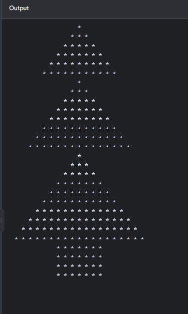
    </td>
    <td align="center" valign="top">
      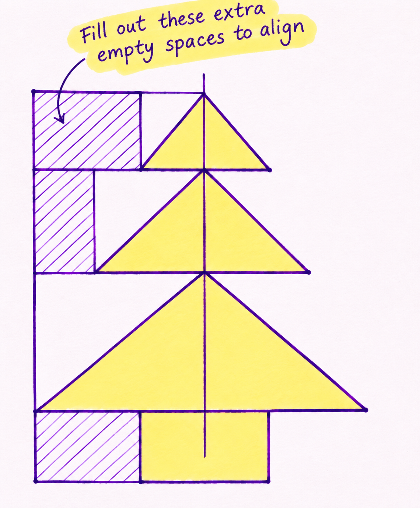
    </td>
    <td valign="top">
      <h3>Logic</h3>
      <ul>
        <li>Created 3 pyramids of increasing heights using separate methods.</li>
        <li>Added leading spaces to align the pyramid sections.</li>
        <li>Used nested loops to print spaces and stars.</li>
        <li>Star formula: <code>2 * i - 1</code>.</li>
        <li>Trunk created using fixed spaces and stars.</li>
      </ul>

      Dry Run: 1, 3, 5, 7, 9...
      Complexity: Time O(n²), Auxiliary Space O(1).
      Key takeaway: Combine patterns and align them with spaces.
    
  </tr>
</table>

## 02. Heart Pattern

<table>
  <tr>
    <td align="center" valign="top">
      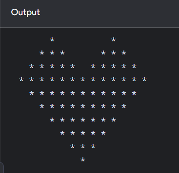
    </td>
    <td align="center" valign="top">
      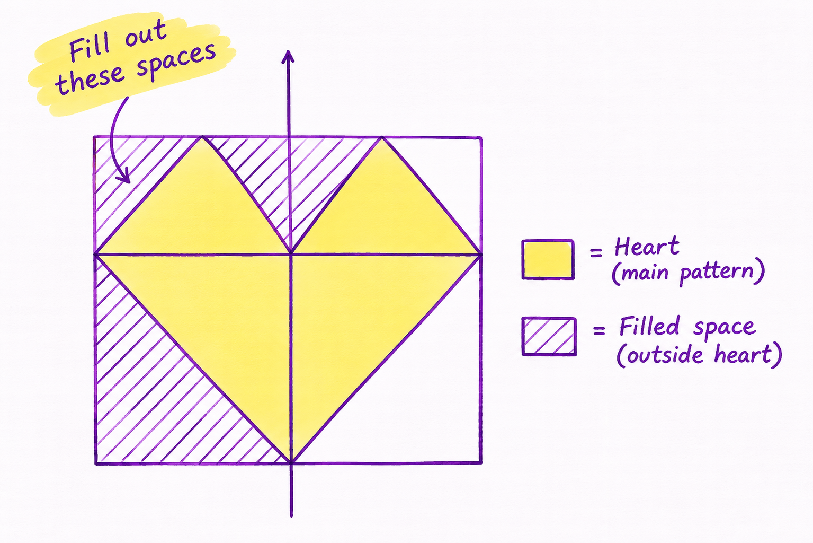
    </td>
    <td valign="top">
      <h3>Logic</h3>
      <ul>
        <li>Used nested loops to print spaces and stars.</li>
        <li>Created the top using 2 upright triangles.</li>
        <li>Decreased the middle gap on each row.</li>
        <li>Used 1 inverted triangle for the bottom.</li>
        <li>Star formula: <code>2 * i - 1</code>.</li>
      </ul>

      Dry Run: 1, 3, 5... and 13, 11, 9...
      Complexity: Time O(n²), Auxiliary Space O(1).
      Key takeaway: Combine 3 triangles to create a heart.
    
  </tr>
</table>

## 03. Diya Pattern

<table>
  <tr>
    <td align="center" valign="top">
      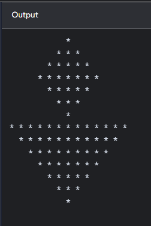
    </td>
    <td align="center" valign="top">
      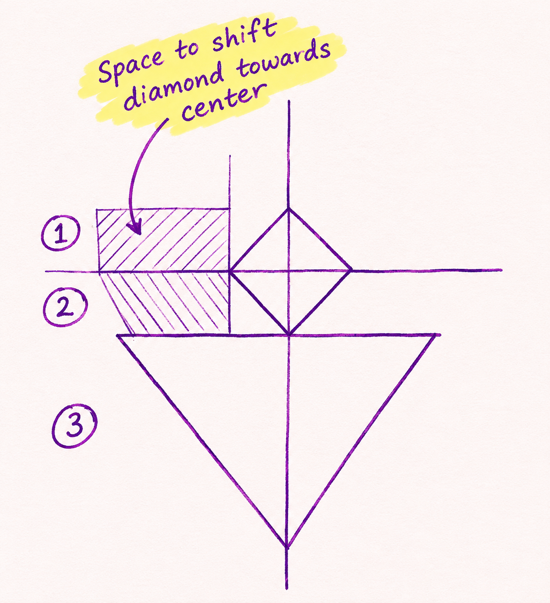
    </td>
    <td valign="top">
      <h3>Logic</h3>
      <ul>
        <li>Divided the pattern into 3 parts.</li>
        <li>Combined the left section, diamond, and inverted triangle.</li>
        <li>Used spaces to align all parts.</li>
      </ul>
      <b>Formulas:</b>
      <ul>
        <li>Spaces: <code>n - i</code></li>
        <li>Stars: <code>2 * i - 1</code></li>
      </ul>
      
      Dry Run: Stars: 1, 3, 5, 7... | Spaces decrease as rows increase.
      Complexity: Time O(n²), Auxiliary Space O(1).
      Key takeaway: Combine smaller patterns to create one design.
    
  </tr>
</table>

## 04.  Dandiya Pattern

<table>
  <tr>
    <td align="center" valign="top">
      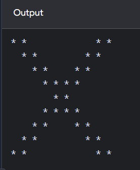
    </td>
    <td align="center" valign="top">

    </td>
    <td valign="top">
      <h3>Logic</h3>
      <ul>
        <li>Divided the X into 2 hollow triangles.</li>
        <li>Combined their diagonal boundaries.</li>
        <li>Used conditions to print stars and spaces.</li>
        <li>Removed unwanted bottom corner stars.</li>
      </ul>
      <b>Formula:</b>
      <ul>
        <li>Inverted: <code>j == i || j == i + 1</code></li>
        <li>Upright: <code>j == n-1-i || j == n-2-i</code></li>
      </ul>
      
      Dry Run: Diagonal positions shift with each row.
      Complexity: Time O(n²), Space O(1).
      Key takeaway: Combine two hollow triangles to create an X.

  </tr>
</table>

## 05. Swastik Pattern

<table>
  <tr>
    <td align="center" valign="top">
      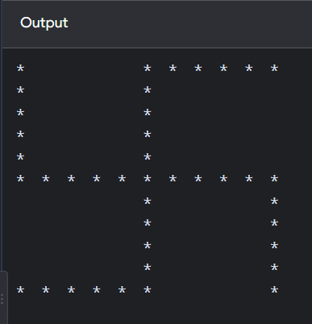
    </td>
    <td align="center" valign="top">
      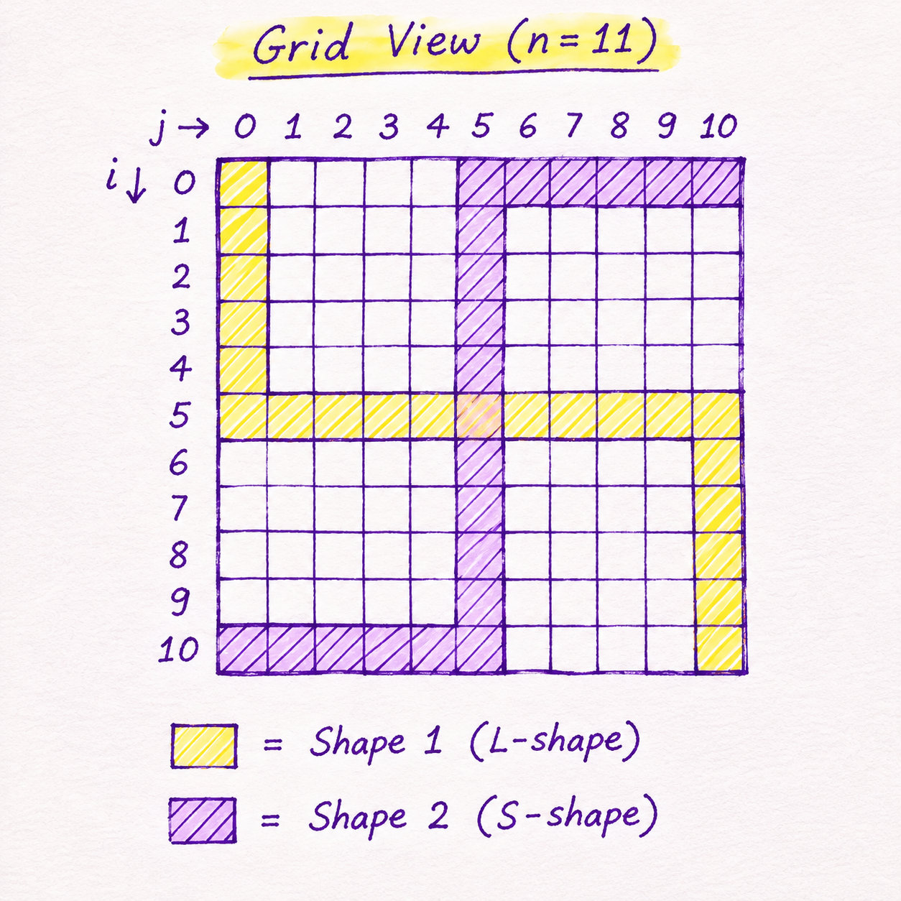
    </td>
    <td valign="top">
      <h3>Logic</h3>
      <ul>
        <li>Divided the pattern into 2 connected shapes.</li>
        <li>Used the midpoint to identify the centre.</li>
        <li>Defined separate conditions for both shapes.</li>
        <li>Combined them using the OR (<code>||</code>) operator.</li>
      </ul>
      <b>Formula:</b>
<ul>
  <li><b>Midpoint:</b> <code>mid = n / 2</code></li>
  <li><b>Shape 1 (L-shape):</b>
    <ul>
      <li>Left vertical: <code>j == 0 && i <= mid</code></li>
      <li>Middle horizontal: <code>i == mid</code></li>
      <li>Right vertical: <code>j == n-1 && i >= mid</code></li>
    </ul>
  </li>
  <li><b>Shape 2 (S-shape):</b>
    <ul>
      <li>Top horizontal: <code>i == 0 && j >= mid</code></li>
      <li>Middle vertical: <code>j == mid</code></li>
      <li>Bottom horizontal: <code>i == n-1 && j <= mid</code></li>
    </ul>
  </li>
</ul>
      
      Complexity: Time: O(n²), Auxiliary Space: O(1)
      Key takeaway:Combine two simple shapes using midpoint-based conditions.
    
  </tr>
</table>

## 06. Aanar (Firecracker) Pattern

<table>
  <tr>
    <td align="center" valign="top">
      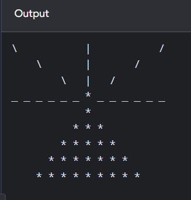
    </td>
    <td align="center" valign="top">
      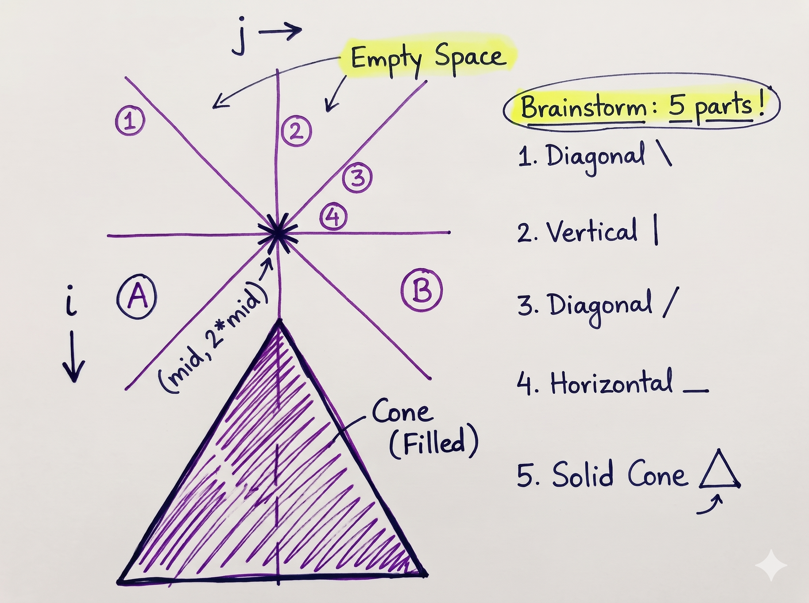
    </td>
    <td valign="top">
      <h3>Logic</h3>
      <ul>
        <li>Divided the pattern into 2 parts.</li>
        <li>Part 1: Created 5 explosion rays using diagonals, vertical and horizontal lines.</li>
        <li>Part 2: Created a filled inverted triangle for the cone.</li>
        <li>Used the same midpoint to align both parts.</li>
      </ul>
        <b>Formula:</b>
      <ul>
          <li>Midpoint: <code>mid = n / 2</code></li>
          <li>Vertical: <code>j == 2 * mid</code></li>
          <li>Left diagonal: <code>j == 2 * i</code></li>
          <li>Right diagonal: <code>j == 2 * (n - 1 - i)</code></li>
           <li>Horizontal: <code>i == mid</code></li>
          <li>Cone: <code>2 * mid - i <= j && j <= 2 * mid + i</code></li>
      </ul>

      Complexity: Time: O(n²), >Auxiliary Space: O(1)
      Key Takeaway: Combine directional rays and a filled triangle.
    
  </tr>
</table>

## 07. Explosion Pattern

<table>
  <tr>
    <td align="center" valign="top">
      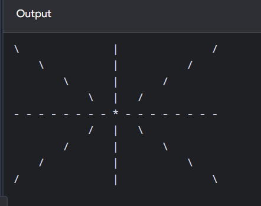
    </td>
    <td align="center" valign="top">
      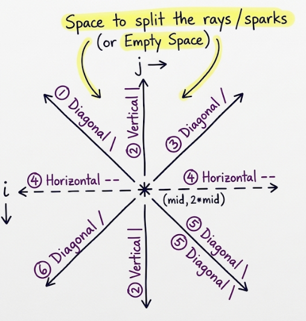
    </td>
    <td valign="top">
      <h3>Logic</h3>
      <ul>
        <li>Used the midpoint to position the centre.</li>
        <li>Created vertical, diagonal and horizontal rays.</li>
        <li>Used separate conditions for each direction.</li>
        <li>Printed a star at the centre.</li>
      </ul>
      <b>Formula:</b>
      <ul>
        <li>Midpoint: <code>mid = n / 2</code></li>
        <li>Centre: <code>i == mid && j == 2 * mid</code></li>
        <li>Horizontal: <code>i == mid</code></li>
        <li>Vertical: <code>j == 2 * mid</code></li>
        <li>Left diagonal: <code>j == 2 * i</code></li>
        <li>Right diagonal: <code>j == 2 * n - 2 - 2 * i</code></li>
      </ul>

      Complexity:Time: O(n²),Auxiliary Space: O(1)
      Key Takeaway: Use midpoint-based conditions for symmetrical explosion.
    
  </tr>
</table>

## 08. Butterfly Pattern

<table>
  <tr>
    <td align="center" valign="top">
      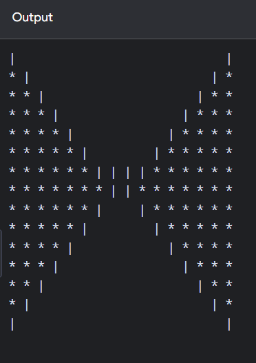
    </td>
    <td align="center" valign="top">
      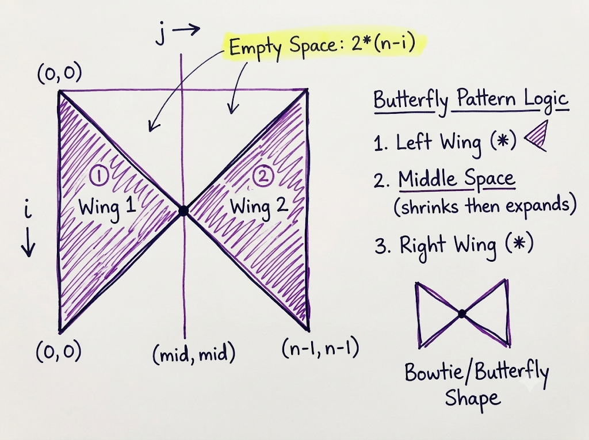
    </td>
    <td valign="top">
      <h3>Logic</h3>
      <ul>
        <li>Divided the pattern into upper and lower halves.</li>
        <li>Printed increasing stars on both sides.</li>
        <li>Used vertical bars to mark the inner boundaries of the wings.</li>
        <li>Adjusted the middle gap to create the butterfly shape.</li>
        <li>Extra vertical line in the upper half for centre detail.</li>
      </ul>
      <b>Formula:</b>
      <ul>
        <li>Stars on each side: <code>i - 1</code></li>
        <li>Middle gap: <code>2 * (n - i)</code></li>
        <li>Lower half: <code>i = n - 1</code> to <code>1</code></li>
        <li>Extra centre detail: <code>i == n - 1</code></li>
      </ul>

      Complexity:Time: O(n²), Auxiliary Space: O(1)   
      Key Takeaway: Create symmetrical wings and a changing middle gap.
  </tr>
</table>

## 09. Square Rangoli Pattern

<table>
  <tr>
    <td align="center" valign="top">
      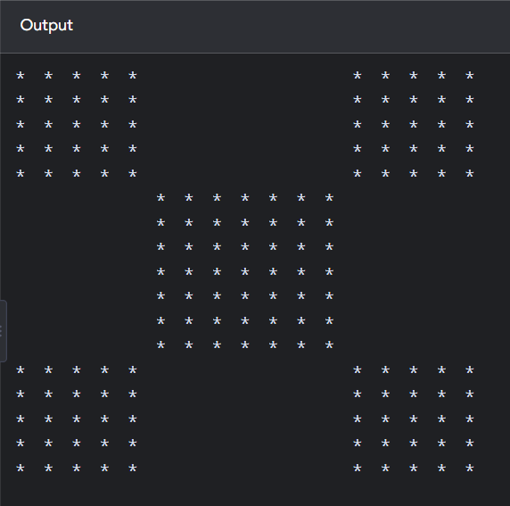
    </td>
    <td align="center" valign="top">
      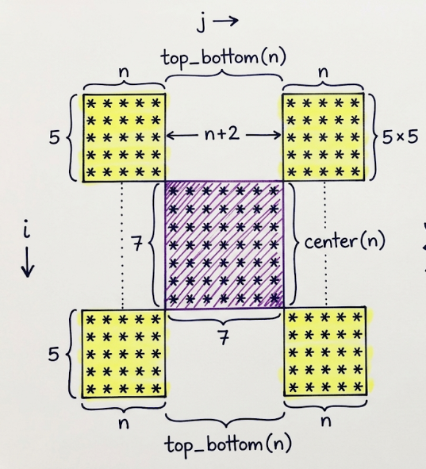
    </td>
    <td valign="top">
      <h3>Logic</h3>
      <ul>
        <li>Divided the pattern into 3 sections.</li>
        <li>Created reusable <code>top_bottom()</code> and <code>center()</code> methods.</li>
        <li>Printed four corner squares and one centre square.</li>
        <li>Used spaces to maintain alignment.</li>
      </ul>
      <b>Formula:</b>
      <ul>
        <li>Corner squares: <code>n × n</code></li>
        <li>Centre square: <code>(n+2) × (n+2)</code></li>
        <li>Middle spacing: <code>n + 2</code></li>
      </ul>

      Complexity:Time: O(n²) , Auxiliary Space: O(1)
      Key Takeaway: Combining reusable square-printing methods.
  </tr>
</table

## 10. Kite Pattern

<table>
  <tr>
    <td align="center" valign="top">
      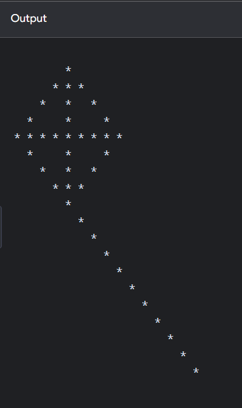
    </td>
    <td align="center" valign="top">
      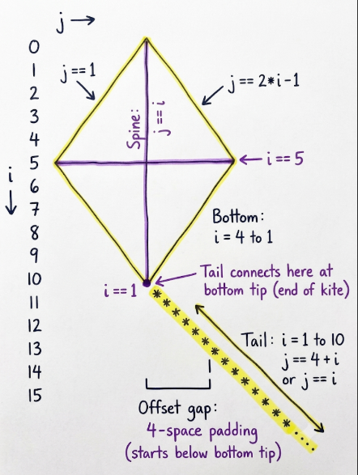
    </td>
    <td valign="top">
      <h3>Logic</h3>
      <ul>
        <li>Divided the pattern into 3 parts.</li>
        <li>Created the upper and lower sections using increasing and decreasing loops.</li>
        <li>Used boundary and middle conditions to form the kite.</li>
        <li>Added a diagonal tail using a separate loop.</li>
      </ul>
      <b>Formula:</b>
      <ul>
        <li>Leading spaces: <code>4 - i</code></li>
        <li>Row width: <code>2 * i - 1</code></li>
        <li>Kite boundaries: <code>j == 1 || j == 2*i-1</code></li>
        <li>Middle line: <code>j == i</code></li>
        <li>Tail: <code>j == i</code></li>
      </ul>

      Complexity:Time: O(n²), Auxiliary Space: O(1)</li>
      Key Takeaway: Combine increasing, decreasing and diagonal patterns to create a kite.
  </tr>
</table>

## 11. Square Rangoli with Diamond

<table>
  <tr>
    <td align="center" valign="top" width="22%">
      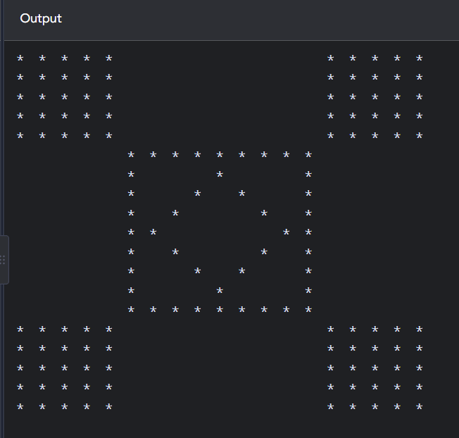
    </td>
    <td align="center" valign="top" width="28%">
      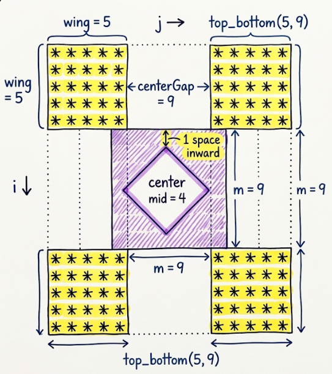
    </td>
    <td valign="top" width="50%">
      <h3>Logic</h3>
      <ul>
        <li>Divided the pattern into outer wings and a centre section.</li>
        <li>Used reusable <code>top_bottom()</code> and <code>center()</code> methods.</li>
        <li>Created a square boundary with four diagonal edges forming a diamond.</li>
        <li>Used separate dimensions for the wings and centre.</li>
      </ul>
      <b>Formula:</b>
      <ul>
        <li>Midpoint: <code>mid = m / 2</code></li>
        <li>Square: <code>i == 0 || i == m-1 || j == 0 || j == m-1</code></li>
        <li>Diamond: Four diagonal conditions based on <code>i</code>, <code>j</code> and <code>mid</code>.</li>
      </ul>

          
      Complexity: Time: O(wing × m + m²), Auxiliary Space: O(1)
      Key Takeaway:Combine square boundaries &
      diagonal conditions to create a layered rangoli pattern.
  </tr>
</table>

