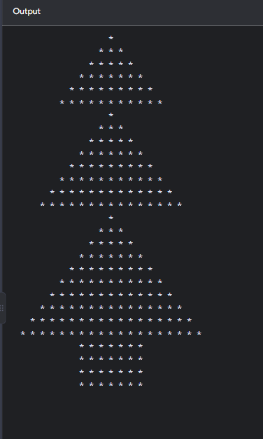
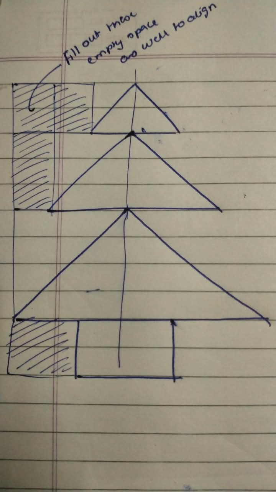

## 01. Christmas Tree

<table>
  <tr>
    <td align="center" valign="top">
      
    </td>
    <td align="center" valign="top">
      
    </td>
    <td valign="top">
      <h3>Logic</h3>
      <ul>
        <li>Created 3 pyramids of increasing heights using separate methods.</li>
        <li>Added leading spaces to align the pyramid sections.</li>
        <li>Used nested loops to print spaces and stars.</li>
        <li>Star formula: <code>2 * i - 1</code>.</li>
        <li>Trunk created using fixed spaces and stars.</li>
      </ul>

      Dry Run:</strong> 1, 3, 5, 7, 9...
      Complexity:</strong> Time O(n²), Auxiliary Space O(1).
      Key takeaway:</strong> Combine patterns and align them with spaces.
    
  </tr>
</table>

