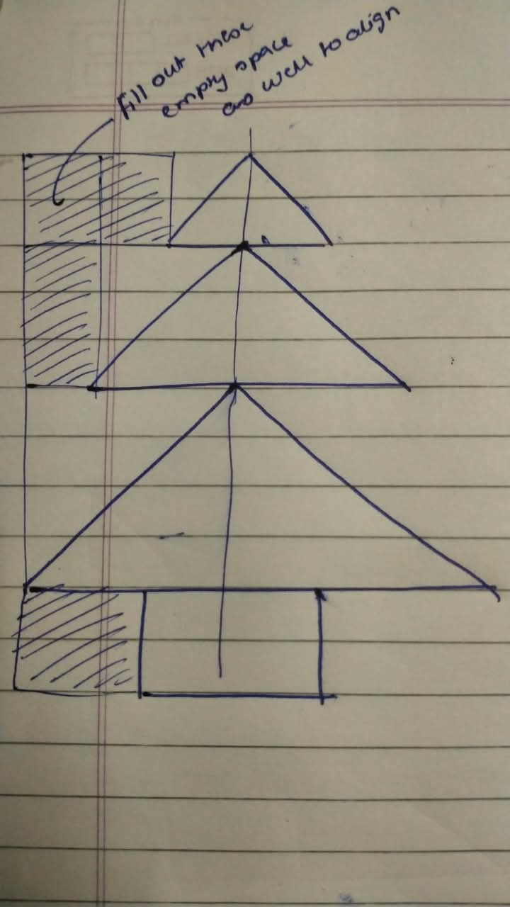
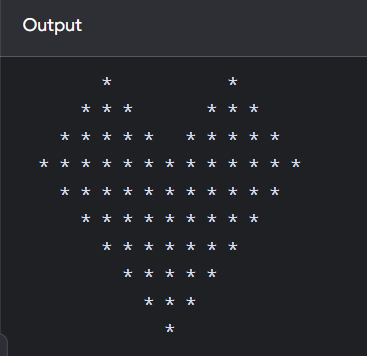
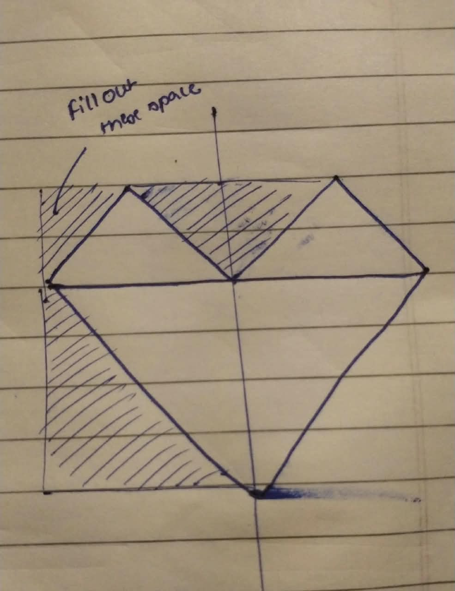
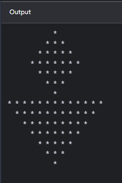
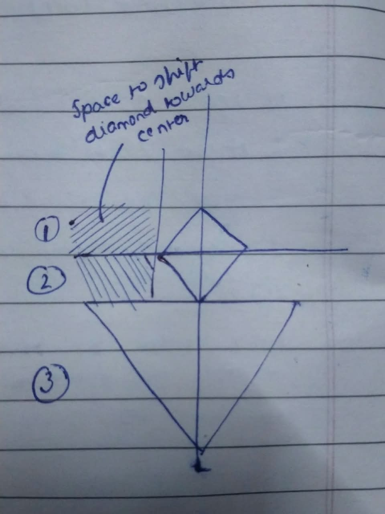

## 01. Christmas Tree

<table>
  <tr>
    <td align="center" valign="top">
      
    </td>
    <td align="center" valign="top">
      
    </td>
    <td valign="top">
      <h3>Logic</h3>
      <ul>
        <li>Created 3 pyramids of increasing heights using separate methods.</li>
        <li>Added leading spaces to align the pyramid sections.</li>
        <li>Used nested loops to print spaces and stars.</li>
        <li>Star formula: <code>2 * i - 1</code>.</li>
        <li>Trunk created using fixed spaces and stars.</li>
      </ul>

      Dry Run: 1, 3, 5, 7, 9...
      Complexity: Time O(n²), Auxiliary Space O(1).
      Key takeaway: Combine patterns and align them with spaces.
    
  </tr>
</table>

## 02. Heart Pattern

<table>
  <tr>
    <td align="center" valign="top">
      
    </td>
    <td align="center" valign="top">
      
    </td>
    <td valign="top">
      <h3>Logic</h3>
      <ul>
        <li>Used nested loops to print spaces and stars.</li>
        <li>Created the top using 2 upright triangles.</li>
        <li>Decreased the middle gap on each row.</li>
        <li>Used 1 inverted triangle for the bottom.</li>
        <li>Star formula: <code>2 * i - 1</code>.</li>
      </ul>

      Dry Run: 1, 3, 5... and 13, 11, 9...
      Complexity: Time O(n²), Auxiliary Space O(1).
      Key takeaway: Combine 3 triangles to create a heart.
    
  </tr>
</table>

## 03. Diya Pattern

<table>
  <tr>
    <td align="center" valign="top">
      
    </td>
    <td align="center" valign="top">
      
    </td>
    <td valign="top">
      <h3>Logic</h3>
      <ul>
        <li>Divided the pattern into 3 parts.</li>
        <li>Combined the left section, diamond, and inverted triangle.</li>
        <li>Used spaces to align all parts.</li>
      </ul>
      <b>Formulas:</b>
      <ul>
        <li>Spaces: <code>n - i</code></li>
        <li>Stars: <code>2 * i - 1</code></li>
      </ul>
      
      Dry Run: Stars: 1, 3, 5, 7... | Spaces decrease as rows increase.
      Complexity: Time O(n²), Auxiliary Space O(1).
      Key takeaway: Combine smaller patterns to create one design.
    
  </tr>
</table>
